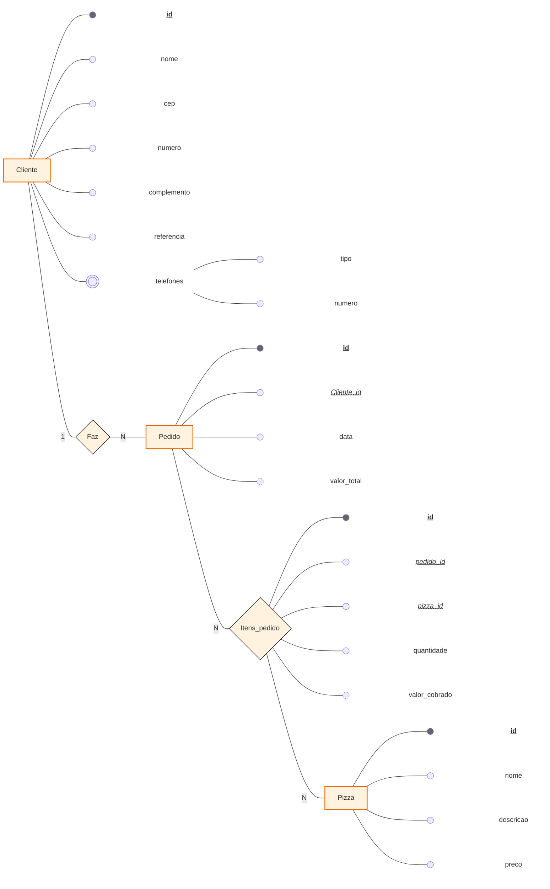
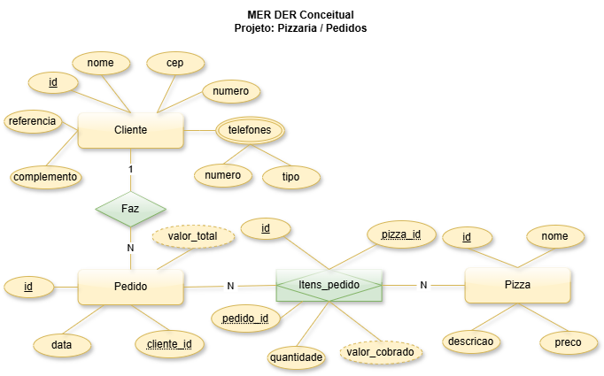
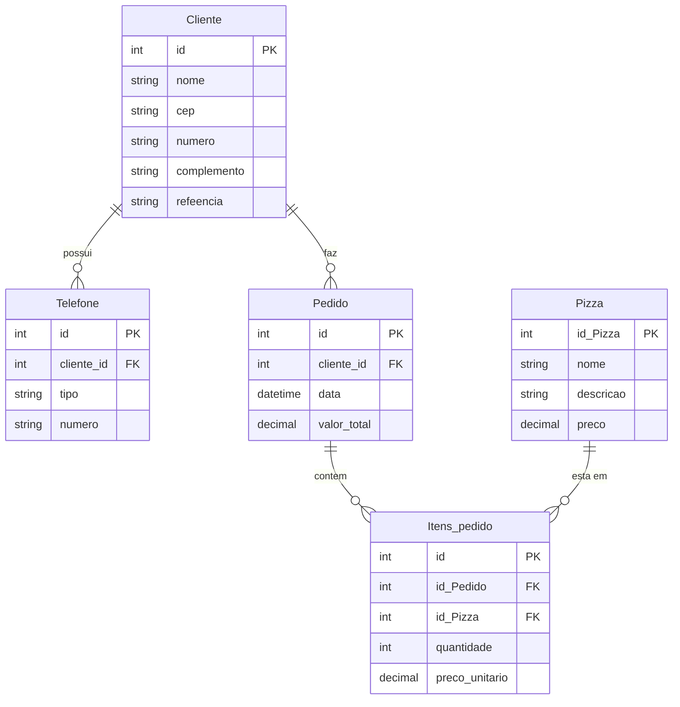

# Pizzaria / Pedidos 2026 - MySQL / MariaDB SQL
Banco de dados com **pedidos** de uma pizzaria contendo MER DER conceitual, lógico e físico (MySQL / MariaDB SQL)

## Exemlos de scripts SQL
- [DDL](./ddl_dml.sql) (Data Definition Language - Linguagem de Definição de Dados): Cria, altera e exclui a estrutura dos objetos do banco (tabelas, [índices](./indices.sql), [visões](./views.sql)).
	- Comandos: CREATE, ALTER, DROP, TRUNCATE.
- [DML](./ddl_dml.sql) (Data Manipulation Language - Linguagem de Manipulação de Dados): Insere, atualiza e apaga os registros dentro das tabelas.
	- Comandos: INSERT, UPDATE, DELETE.
- [DQL](./queries.sql) (Data Query Language - Linguagem de Consulta de Dados): Busca e recupera informações armazenadas. (Nota: Alguns autores incluem o SELECT dentro da DML).
	- Comandos: SELECT.
- DCL (Data Control Language - Linguagem de Controle de Dados): Gerencia permissões, segurança e acesso dos usuários.
	- Comandos: GRANT, REVOKE.
- [TCL](./transactions.sql) (Transaction Control Language - Linguagem de Controle de Transação): Controla as alterações feitas pelos comandos DML, garantindo a integridade dos dados.
	- Comandos: COMMIT, ROLLBACK, SAVEPOINT.

## Exemplo de programação em banco de dados

|Estrutura|O que faz|Como é acionada|Retorno|
|-|-|-|-|
|[Function](./functions.sql) (Função)|Executa um cálculo ou rotina e devolve um resultado.|Chamada diretamente dentro de uma consulta (ex: no SELECT ou WHERE).|Obrigatório (retorna um valor único ou uma tabela).|
|[Stored Procedure](./procedures.sql) (Procedimento)|Executa uma sequência de comandos complexos e regras de negócio.|Chamada explicitamente por um comando (ex: EXEC ou CALL).|Opcional (pode não retornar nada, retornar um status ou vários conjuntos de dados).|
|[Trigger](./triggers.sql) (Gatilho)|Audita, valida ou automatiza ações em cascata nas tabelas.|Automática, disparada por eventos (INSERT, UPDATE ou DELETE).|

## MER (Modelo Entidade Relacionamento)
### DER Conceitual
- Notação básica

- Notação de Peter Cheen
<br>
### DER Lógico


### Dicionário de dados

|Entidade|Atributo|Tipo|Tamanho|pode ser<br>nulo|Descrição|
|-|-|:-:|:-:|:-:|-|
|Cliente|id|Int||não|Identificador Auto incremental|
|Cliente|nome|Varchar|100|não|Nome do cliente|
|Cliente|cep|Varchar|100|não|Código postal, para obter via API logradouro, Bairro, Cidade e Estado|
|Cliente|numero|Varchar|10|sim|Número da residência|
|Cliente|complenento|Varchar|50|sim|Frente, fundos, Apartamento e Bloco|
|Cliente|referencia|Varchar|50|sim|Ponto de refeência|
|Telefone|id|Int||não|Identificador Auto incremental|
|Telefone|cliente_id|Int||não|Chave estrangeira que referencia: Cliente(id)|
|Telefone|tipo|Varchar|20|não|Pode ser enumeração [Celular, Residencial, Comercial]|
|Telefone|numero|Varchar|20|não|Número do telefone|
|Pizza|id|Int||não|Identificador Auto incremental|
|Pizza|nome|Varchar|100|não|Nome da pizza|
|Pizza|descricao|Varchar|512|não|Descrição dos ingredientes|
|Pizza|preco|Decimal|8,2|não|Preço da pizza|
|Pedido|id|Int||não|Identificador Auto incremental|
|Pedido|cliente_id|Int||não|Chave estrangeira que referencia: Cliente(id)|
|Pedido|data|datetime||não|Pode ter valor padrão a data e hora do sismtema|
|Pedido|valor_total|Decimal|8,2|sim|Campo derivado, pode ser calculado somando os ítens do pedido|
|Itens_pedido|id|Int||não|Identificador Auto incremental|
|Itens_pedido|pedido_id|Int||não|Chave estrangeira que referencia: Pedido(id)|
|Itens_pedido|pizza_id|Int||não|Chave estrangeira que referencia: Pizza(id)|
|Itens_pedido|quantidade|Decimal|6,2|não|Quantidade, tipo decimal pois permite mais de um sabor por pizza (Meio a meio)|
|Ítens_pedido|valor_cobrado|Decimal|8,2|não|Campo pode ser preenchido com valor diferente do preço caso de promoções ou acrescimos, pode ser derivado multiplicando a quantidade pelo preço da pizza|

### Modelo fízico
- Modelo já em linguagem SQL DDL, script de criação com índices visões funções, procedimentos e gatilhos.

```sql
drop database if exists Pizzaria;
create database Pizzaria charset=UTF8 collate utf8_general_ci;
use Pizzaria;

create table Cliente(
	id integer primary key auto_increment,
	nome varchar(70) not null,
	cep varchar(20) not null,
	numero varchar(10),
	complemento varchar(30),
	referencia varchar(30)
);

create table Telefone(
	id integer primary key auto_increment,
	cliente_id integer not null,
	tipo ENUM('celular', 'residencial', 'comercial') not null default('celular'),
	numero varchar(15) not null,
	foreign key (cliente_id) references Cliente(id) on delete cascade
);

create table Pizza(
	id integer primary key auto_increment,
	nome varchar(30) not null,
	descricao varchar(200) not null,
	preco decimal(8,2) not null
);

create table Pedido(
	id integer primary key auto_increment,
	cliente_id integer not null,
	data datetime not null default(now()),
	valor_total decimal(8,2),
	foreign key (cliente_id) references Cliente(id)
);

create table Itens_Pedido(
	id integer primary key auto_increment,
	pedido_id integer,
	pizza_id integer not null,
	quantidade decimal(5,2) not null,
	valor_cobrado decimal(8,2) not null,
	foreign key (pedido_id) references Pedido(id) on delete cascade,
	foreign key (pizza_id) references Pizza(id)
);

CREATE INDEX i_nome on cliente(nome);

create view vw_clientes as
select c.*, t.numero as telefone, t.tipo from Cliente c inner join telefone t on c.id = t.cliente_id;
select * from vw_clientes limit 10;
select * from Pizza limit 10;
select * from Pedido limit 10;
select * from Itens_Pedido limit 10;

delimiter //
create function moeda(v float) returns text
begin
    declare x varchar(20);
    set x = format(v,2,'de_DE');
    return concat("R$ ",x);
end//
delimiter ;

DROP VIEW IF EXISTS vw_pedidos_full;
CREATE VIEW vw_pedidos_full AS
SELECT p.*, i.pizza_id, i.quantidade, moeda(i.valor_cobrado) AS preco, moeda(i.valor_cobrado * i.quantidade) AS subtotal,
c.nome, pi.nome AS pizza
FROM pedido p INNER JOIN itens_pedido i
ON p.id = i.pedido_id
LEFT JOIN cliente c
ON p.cliente_id = c.id
LEFT JOIN pizza pi
ON i.pizza_id = pi.id;

DROP PROCEDURE IF EXISTS pedidoDeUmItem;
DELIMITER //
CREATE PROCEDURE pedidoDeUmItem(_cliente_id INT, _pizza_id INT, _qtd INT)
BEGIN
    DECLARE _pedido_id INT;
    INSERT INTO pedido (cliente_id, data)
    VALUES (_cliente_id, NOW());
    SET _pedido_id = LAST_INSERT_ID();
    INSERT INTO itens_pedido (pedido_id, pizza_id, quantidade, valor_cobrado)
    VALUES (_pedido_id, _pizza_id, _qtd, (SELECT preco FROM pizza WHERE id = _pizza_id));
    UPDATE pedido
    SET valor_total = (SELECT SUM(valor_cobrado * quantidade) FROM itens_pedido WHERE pedido_id = _pedido_id)
    WHERE id = _pedido_id;
END //
DELIMITER ;

DROP TRIGGER IF EXISTS trg_atualiza_valor_pedido;
DELIMITER //
CREATE TRIGGER trg_atualiza_valor_pedido
AFTER INSERT ON itens_pedido
FOR EACH ROW
BEGIN
    UPDATE pedido
    SET valor_total = (
        SELECT COALESCE(SUM(valor_cobrado * quantidade), 0)
        FROM itens_pedido
        WHERE pedido_id = NEW.pedido_id
    )
    WHERE id = NEW.pedido_id;
END //
DELIMITER ;
SHOW TRIGGERS;

describe Cliente;
describe Telefone;
describe Pizza;
describe Pedido;
describe Itens_Pedido;
show tables;
```

## Testes
- Script DML com alguns dados de teste
```sql
use pizzaria;
insert into Cliente(nome, cep, numero, complemento, referencia) values
("Adelcio Biazi","13905-621","1204","Fundos","Igreja"),
("Adriano da Silva Ferreira","13905-527","1206",null,"Farmacia"),
("Alisson Linhares de Carvalho","13900-540","1208",null,null);

insert into Telefone(cliente_id, numero) values (1,"19993452345");
insert into Telefone(cliente_id, tipo, numero) values (1, 'residencial', '1938001001');
insert into Telefone(cliente_id, numero) values (2,"19932342344");
insert into Telefone(cliente_id, tipo, numero) values (2, 'comercial', '1938002002');
insert into Telefone(cliente_id, numero) values (3,"1934567832"), (3,"1930022834");

insert into Pizza(nome, descricao, preco) values
("A Moda da Casa","Molho de tomate fresco, mussarela especial, presunto cozido picado, ovos, cebola fatiada, cobertura de catupiry, oregano e azeitonas pretas",32.93),
("Alho e oleo","Molho de tomate fresco, alho crocante coberto com parmesao, oregano e azeitonas pretas",32.77),
("Aliche","Molho especial de tomate fresco, files de aliche importado, oregano e azeitonas pretas",32.61),
("Ao Funghi","Molho de tomate fresco, mussarela especial, champignon fatiado, manjericao fresco, oregano e azeitonas pretas",32.45),
("Atum","Molho de tomate fresco, atum especial solido, cebola fatiada, oregano e azeitonas pretas",32.29),
("Baiana","Molho de tomate fresco, calabresa moida levemente apimentada, ovos cozidos picados, cebola fatiada, oregano e azeitonas pretas",32.13);

insert into Pedido(cliente_id, data) values
(1, TIMESTAMP(DATE_SUB(CURDATE(), INTERVAL 10 DAY), "13:54:00")),
(2, TIMESTAMP(DATE_SUB(CURDATE(), INTERVAL 10 DAY), "12:12:00")),
(2, TIMESTAMP(DATE_SUB(CURDATE(), INTERVAL 10 DAY), "14:12:00")),
(3, TIMESTAMP(DATE_SUB(CURDATE(), INTERVAL 10 DAY), "14:15:00"));

insert into Itens_Pedido(pedido_id, pizza_id, quantidade, valor_cobrado) values
(1,1,0.5, (select preco / 2 from Pizza where id = 1)),
(1,3,0.5, (select preco / 2 from Pizza where id = 3)),
(1,5,3, (select preco from Pizza where id = 5)),
(2,4,0.5, (select preco / 2 from Pizza where id = 4)),
(2,2,0.5, (select preco / 2 from Pizza where id = 2)),
(2,5,5, (select preco from Pizza where id = 5)),
(2,3,1, (select preco from Pizza where id = 3)),
(2,6,2, (select preco from Pizza where id = 6)),
(2,1,3, (select preco from Pizza where id = 1)),
(2,2,4, (select preco from Pizza where id = 2)),
(3,4,5, (select preco from Pizza where id = 4)),
(3,5,1, (select preco from Pizza where id = 5)),
(3,6,2, (select preco from Pizza where id = 6));

select * from pizza;
select * from vw_clientes;
select * from vw_pedidos_full;

```