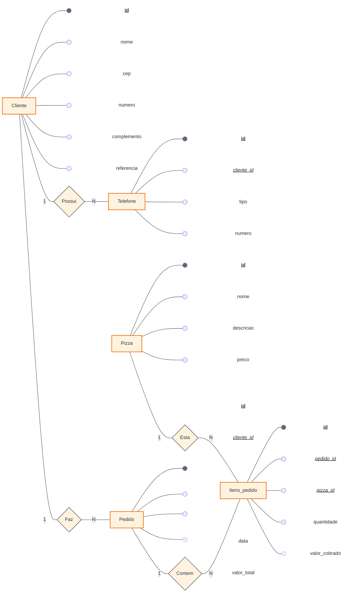

# Pizzaria / Pedidos 2026 - MySQL / MariaDB SQL
Banco de dados com **pedidos** de uma pizzaria contendo MER DER conceitual, lógico e físico (MySQL / MariaDB SQL)

## Exemlos de scripts SQL
- [DDL](./ddl_dml.sql) (Data Definition Language - Linguagem de Definição de Dados): Cria, altera e exclui a estrutura dos objetos do banco (tabelas, [índices](./indices.sql), [visões](./views.sql)).
	- Comandos: CREATE, ALTER, DROP, TRUNCATE.
- [DML](./ddl_dml.sql) (Data Manipulation Language - Linguagem de Manipulação de Dados): Insere, atualiza e apaga os registros dentro das tabelas.
	- Comandos: INSERT, UPDATE, DELETE.
- [DQL](./queries.sql) (Data Query Language - Linguagem de Consulta de Dados): Busca e recupera informações armazenadas. (Nota: Alguns autores incluem o SELECT dentro da DML).
	- Comandos: SELECT.
- DCL (Data Control Language - Linguagem de Controle de Dados): Gerencia permissões, segurança e acesso dos usuários.
	- Comandos: GRANT, REVOKE.
- [TCL](./transactions.sql) (Transaction Control Language - Linguagem de Controle de Transação): Controla as alterações feitas pelos comandos DML, garantindo a integridade dos dados.
	- Comandos: COMMIT, ROLLBACK, SAVEPOINT.

## Exemplo de programação em banco de dados

|Estrutura|O que faz|Como é acionada|Retorno|
|-|-|-|-|
|[Function](./functions.sql) (Função)|Executa um cálculo ou rotina e devolve um resultado.|Chamada diretamente dentro de uma consulta (ex: no SELECT ou WHERE).|Obrigatório (retorna um valor único ou uma tabela).|
|[Stored Procedure](./procedures.sql) (Procedimento)|Executa uma sequência de comandos complexos e regras de negócio.|Chamada explicitamente por um comando (ex: EXEC ou CALL).|Opcional (pode não retornar nada, retornar um status ou vários conjuntos de dados).|
|[Trigger](./triggers.sql) (Gatilho)|Audita, valida ou automatiza ações em cascata nas tabelas.|Automática, disparada por eventos (INSERT, UPDATE ou DELETE).|

## MER (Modelo Entidade Relacionamento)
### DER Conceitual

